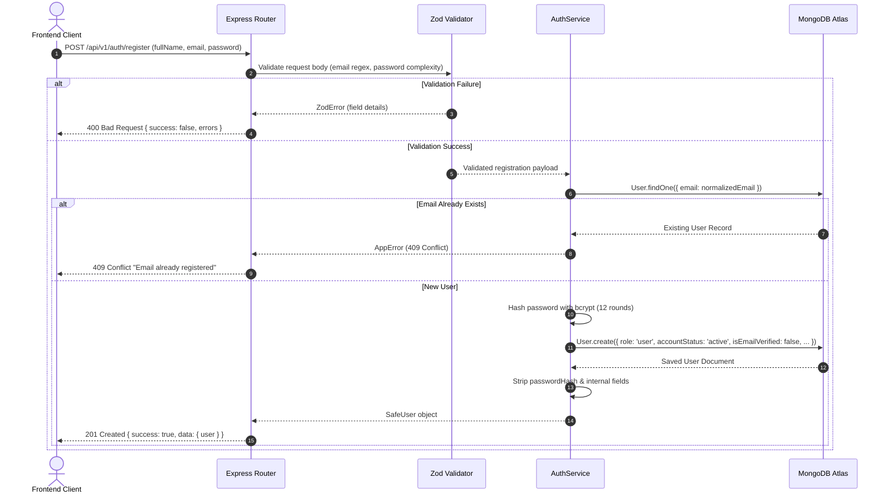
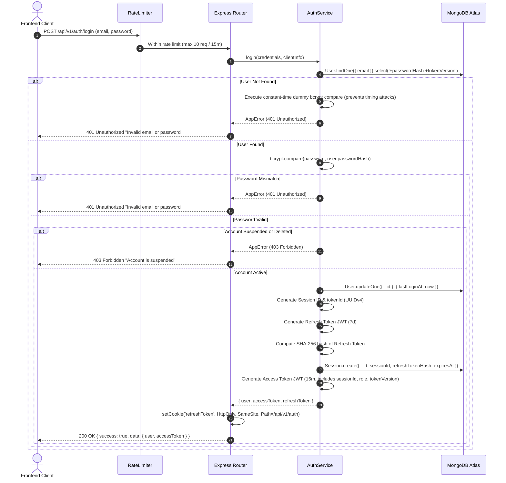
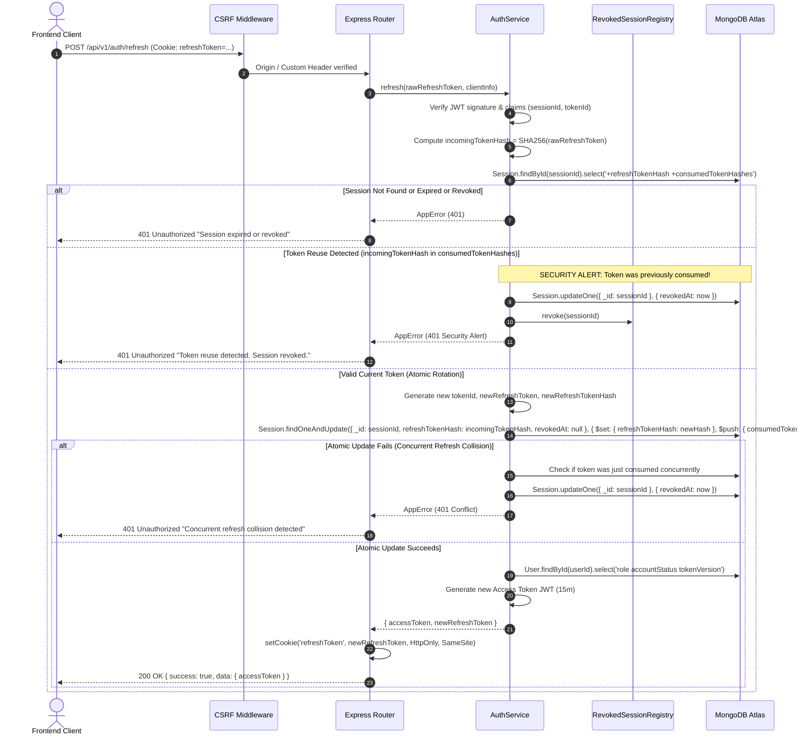
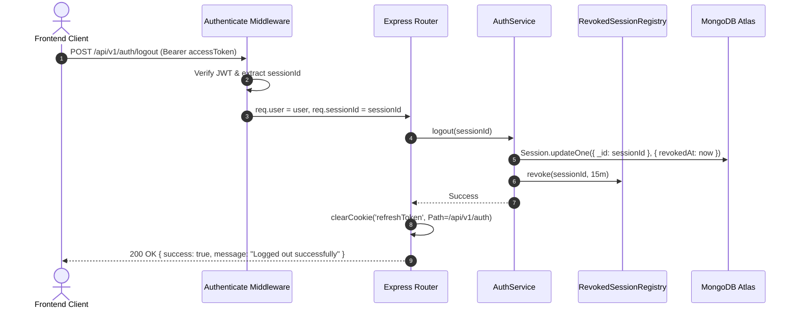
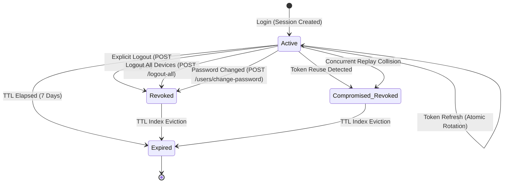

# InsightFlow — Authentication & Authorization Architecture

> **Document Type:** Security & Architectural Specification
> **Milestone:** Milestone 2 — Complete Authentication & Authorization System
> **Audience:** Senior Backend Engineers, Security Auditors, Frontend Leads
> **Repository:** `InsightFlow/insightflow-backend`
> **Last Updated:** 2026-11-06

---

## 1. Architectural Overview

InsightFlow employs a defense-in-depth, token-pair authentication model designed for stateless scale and robust session security:

- **Access Token:** Short-lived JWT (~15 minutes) signed with `JWT_ACCESS_SECRET`. Stored exclusively in frontend application memory (never in `localStorage` or `sessionStorage`). Sent via `Authorization: Bearer <token>` header.
- **Refresh Token:** Long-lived JWT (~7 days) signed with `JWT_REFRESH_SECRET`. Stored in a secure `HttpOnly` cookie with path scoping (`/api/v1/auth`). Associated with a MongoDB `Session` document.
- **Refresh Token Rotation & Token-Family Strategy:** Every refresh request atomically rotates the refresh token, invalidating the previous one and recording its cryptographic SHA-256 hash in a bounded `consumedTokenHashes` family history.
- **Token Reuse Detection:** If an already-consumed refresh token is presented, the system detects a potential token replay/theft, revokes the entire session immediately, and alerts security audit logs.
- **Atomic Concurrency Handling:** Eliminates race conditions across concurrent refresh calls via MongoDB atomic find-and-modify operations without requiring multi-document distributed transactions.
- **Revocation & Invalidation Strategy:** Hybrid model pairing a User-level `tokenVersion` counter with an in-memory TTL `RevokedSessionRegistry` to instantly drop revoked sessions without hitting the database on every micro-request.
- **Email Verification Policy:** Documented non-blocking login policy for unverified accounts.

---

## 2. Sequence Diagrams

### 2.1 User Registration Flow

---

### 2.2 User Login Flow

---

### 2.3 Atomic Refresh Token Rotation & Reuse Detection

---

### 2.4 Logout & Session Revocation

---

## 3. Session Lifecycle State Machine

---

## 4. Security & Implementation Decisions

### 4.1 Token-Family Strategy & Reuse Detection
- Refresh tokens are signed JWTs containing a unique `tokenId` (UUID v4) and the persistent `sessionId`.
- Stored tokens are never kept in plaintext; MongoDB stores a SHA-256 digest `refreshTokenHash`.
- The `consumedTokenHashes` array maintains a rolling history of the last 20 rotated tokens.
- If an old token is intercepted and later presented by an attacker (or replayed), the server detects that the token is present in `consumedTokenHashes`, immediately revokes the session in MongoDB, logs a security alert, and rejects the request.

### 4.2 Concurrency Strategy Without Assuming MongoDB Transactions
- MongoDB multi-document transactions require replica set or sharded deployments. To guarantee universal support across standalone test instances, local development, and MongoDB Atlas clusters:
- The refresh rotation uses an atomic single-document `findOneAndUpdate` operation with an exact filter condition:
  `{ _id: sessionId, refreshTokenHash: incomingTokenHash, revokedAt: { $exists: false }, expiresAt: { $gt: new Date() } }`
- Because MongoDB applies document-level write locks atomically to single-document updates, if two concurrent requests present the identical token simultaneously, **exactly one** operation succeeds. The second operation receives `null`, detects the race condition, and revokes the session to safeguard account integrity.

### 4.3 Revocation Without Unnecessary MongoDB Queries on Every Request
- Checking the database on every microsecond HTTP request degrades latency and database connection pools.
- InsightFlow implements a **two-tier revocation strategy**:
  1. **User `tokenVersion`**: Stored on `User` and embedded in each access token. When `logout-all` or `change-password` executes, `tokenVersion` increments atomically. Any outstanding access tokens bearing an older `tokenVersion` fail immediately upon user lookup.
  2. **In-Memory `RevokedSessionRegistry`**: When an individual session logs out, its `sessionId` is logged in an in-memory TTL map that persists for 15 minutes (the maximum lifetime of an access token). Subsequent requests presenting that session ID are rejected immediately without database traversal. Once 15 minutes elapse, the access token naturally expires by cryptographic signature.

### 4.4 Email Verification Policy
- In Milestone 2, email delivery services (SMTP/SendGrid) and email verification link flows are intentionally not yet implemented.
- **Login Policy:** Users with `isEmailVerified: false` **are permitted to log in and use platform features**, with their verification status accurately reflected in `User` documents and `/api/v1/users/me` responses.
- The platform does not claim email verification exists until the dedicated transactional email infrastructure is deployed in a future milestone.

### 4.5 Cookie & CSRF Defense Topology
- **Cookie Attributes:**
  - `HttpOnly: true` (prevents XSS token exfiltration via JavaScript `document.cookie`).
  - `Path: /api/v1/auth` (limits cookie transmission strictly to auth routes).
  - `SameSite: "lax"` (compatible with cross-port development on localhost:5173 to localhost:5000 and same-site production topologies).
  - `Secure: true` in production (enforced via `COOKIE_SECURE`).
- **CSRF Protection:**
  - Origin/Referer matching against `FRONTEND_URL` on all state-changing cookie-authenticated endpoints.
  - Requirement of non-simple request headers (`X-Requested-With` or `Content-Type: application/json`) which browsers refuse to dispatch across origins without explicit CORS preflight authorization.
