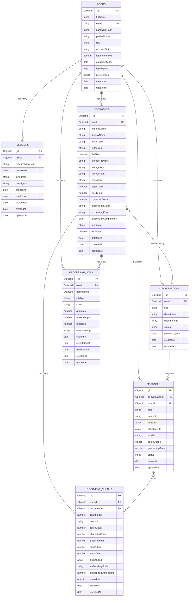

# InsightFlow — Database Architecture

> **Version:** 1.0.0
> **Phase:** Database Architecture and Data Model Implementation
> **Last Updated:** 2026-11-06

## Overview

InsightFlow uses **MongoDB Atlas** (free-tier cluster, AWS Mumbai) as its primary datastore, accessed through **Mongoose 9.12.0** ODM. The database is named `insightflow`.

The architecture is designed around seven collections that support the core platform features: user authentication, document management, AI-powered conversations, and document processing pipelines.

---

## Entity-Relationship Diagram



---

## Collections

### 1. Users (`users`)

Stores registered user accounts.

| Field | Type | Required | Description |
|---|---|---|---|
| `_id` | ObjectId | auto | Primary key |
| `fullName` | String | ✅ | User's full name (1–200 chars) |
| `email` | String | ✅ | Unique, normalized to lowercase |
| `passwordHash` | String | ✅ | bcrypt hash. **Never returned in API responses** (`select: false` + toJSON transform) |
| `profilePicture` | String | | URL to profile image |
| `role` | String | ✅ | Enum: `user`, `admin`. Default: `user` |
| `accountStatus` | String | ✅ | Enum: `active`, `suspended`, `deleted`. Default: `active` |
| `isEmailVerified` | Boolean | ✅ | Default: `false` |
| `emailVerifiedAt` | Date | | When email was verified |
| `lastLoginAt` | Date | | Last login timestamp |
| `preferences` | Object | ✅ | `{ theme, language, notificationsEnabled }` |
| `createdAt` | Date | auto | Mongoose timestamp |
| `updatedAt` | Date | auto | Mongoose timestamp |

**Security:**
- `passwordHash` is excluded by default via `select: false`
- `toJSON` and `toObject` transforms strip `passwordHash` and `__v`
- Email is auto-lowercased and trimmed before storage

### 2. Sessions (`sessions`)

Tracks refresh-token-based authentication sessions per user/device.

| Field | Type | Required | Description |
|---|---|---|---|
| `_id` | ObjectId | auto | Primary key |
| `userId` | ObjectId | ✅ | References `users._id` |
| `refreshTokenHash` | String | ✅ | Hashed refresh token. **Never stored in plaintext** (`select: false`) |
| `deviceInfo` | Object | | `{ deviceType, os, browser }` |
| `ipAddress` | String | | Client IP at session creation |
| `userAgent` | String | | Raw User-Agent header |
| `expiresAt` | Date | ✅ | Session expiry; TTL index auto-deletes expired sessions |
| `revokedAt` | Date | | If set, session is revoked |
| `lastUsedAt` | Date | ✅ | Updated on each token refresh |
| `createdAt` | Date | auto | Mongoose timestamp |
| `updatedAt` | Date | auto | Mongoose timestamp |

**Security:**
- `refreshTokenHash` uses `select: false` — never returned in queries unless explicitly requested
- TTL index on `expiresAt` ensures expired sessions are garbage-collected by MongoDB

### 3. Documents (`documents`)

Stores document metadata. Actual binary files are stored externally (local filesystem or cloud storage).

| Field | Type | Required | Description |
|---|---|---|---|
| `_id` | ObjectId | auto | Primary key |
| `userId` | ObjectId | ✅ | References `users._id` (document owner) |
| `originalName` | String | ✅ | Original upload filename (max 500 chars) |
| `displayName` | String | ✅ | User-facing display name (max 500 chars) |
| `mimeType` | String | ✅ | Restricted to: `application/pdf`, `application/vnd.openxmlformats-officedocument.wordprocessingml.document`, `text/plain` |
| `extension` | String | ✅ | Restricted to: `.pdf`, `.docx`, `.txt` |
| `fileSize` | Number | ✅ | Bytes. Min: 1, Max: 52,428,800 (50 MB) |
| `storageProvider` | String | ✅ | Enum: `local`, `gcs`, `s3`. Default: `local` |
| `storageKey` | String | ✅ | Unique key in storage system |
| `storagePath` | String | ✅ | Full path in storage system |
| `checksum` | String | | File hash for integrity verification |
| `pageCount` | Number | | Extracted page count |
| `wordCount` | Number | | Extracted word count |
| `characterCount` | Number | | Extracted character count |
| `processingStatus` | String | ✅ | See processing statuses below |
| `processingError` | String | | Error message if processing failed |
| `processingCompletedAt` | Date | | When processing finished |
| `metadata` | Object | ✅ | Extensible: `{ title, author, subject, language, ... }` |
| `isDeleted` | Boolean | ✅ | Soft-delete flag. Default: `false` |
| `deletedAt` | Date | | When soft-deleted |
| `createdAt` | Date | auto | Mongoose timestamp |
| `updatedAt` | Date | auto | Mongoose timestamp |

**Processing Statuses:**
`uploaded` → `queued` → `processing` → `extracting` → `chunking` → `embedding` → `completed`
Any stage can → `failed`

**Soft Deletion:**
Query middleware on `find`, `findOne`, and `countDocuments` automatically filters out documents where `isDeleted: true` unless the query explicitly sets `isDeleted`.

### 4. Document Chunks (`document_chunks`)

Stores text segments extracted from documents, along with vector embeddings for semantic search.

| Field | Type | Required | Description |
|---|---|---|---|
| `_id` | ObjectId | auto | Primary key |
| `userId` | ObjectId | ✅ | References `users._id` (for ownership enforcement) |
| `documentId` | ObjectId | ✅ | References `documents._id` |
| `chunkIndex` | Number | ✅ | Positional index within the document (0-based) |
| `content` | String | ✅ | Text content of the chunk |
| `tokenCount` | Number | | LLM token count |
| `characterCount` | Number | | Character count |
| `pageNumber` | Number | | Source page (1-based) |
| `startOffset` | Number | | Character start offset in source text |
| `endOffset` | Number | | Character end offset in source text |
| `embedding` | Number[] | | Vector embedding (`select: false`) |
| `embeddingModel` | String | | Model used for embedding |
| `embeddingDimensions` | Number | | Dimensions of the embedding vector |
| `metadata` | Object | ✅ | `{ pageNumber, section, heading, ... }` (extensible) |
| `createdAt` | Date | auto | Mongoose timestamp |
| `updatedAt` | Date | auto | Mongoose timestamp |

**Uniqueness:** Compound unique index on `(documentId, chunkIndex)` prevents duplicate chunk positions.

**Vector Search Preparation:**
The `embedding` field stores float arrays but is excluded from default queries via `select: false` for performance. The required Atlas Vector Search index **must be created through the Atlas UI or API once an embedding model and dimensions are finalized** — it cannot be created via Mongoose. See the documented configuration template in the model file.

### 5. Conversations (`conversations`)

Represents AI chat conversations that may span one or multiple documents.

| Field | Type | Required | Description |
|---|---|---|---|
| `_id` | ObjectId | auto | Primary key |
| `userId` | ObjectId | ✅ | References `users._id` |
| `title` | String | ✅ | Conversation title (max 300 chars) |
| `description` | String | | Optional description (max 1,000 chars) |
| `documentIds` | ObjectId[] | ✅ | References to `documents._id`. Max 50 per conversation |
| `status` | String | ✅ | Enum: `active`, `archived`. Default: `active` |
| `lastMessageAt` | Date | | Updated when a new message is added |
| `createdAt` | Date | auto | Mongoose timestamp |
| `updatedAt` | Date | auto | Mongoose timestamp |

### 6. Messages (`messages`)

Individual messages within conversations.

| Field | Type | Required | Description |
|---|---|---|---|
| `_id` | ObjectId | auto | Primary key |
| `conversationId` | ObjectId | ✅ | References `conversations._id` |
| `userId` | ObjectId | ✅ | References `users._id` |
| `role` | String | ✅ | Enum: `user`, `assistant`, `system` |
| `content` | String | ✅ | Message text (max 50,000 chars) |
| `citations` | Array | ✅ | `[{ documentId, chunkId, content, pageNumber?, relevanceScore? }]` |
| `attachments` | Array | ✅ | `[{ documentId, fileName, mimeType }]` |
| `model` | String | | AI model identifier |
| `tokenUsage` | Object | | `{ promptTokens, completionTokens, totalTokens }` |
| `processingTime` | Number | | Milliseconds for AI response generation |
| `status` | String | ✅ | Enum: `pending`, `completed`, `failed`. Default: `completed` |
| `createdAt` | Date | auto | Mongoose timestamp |
| `updatedAt` | Date | auto | Mongoose timestamp |

### 7. Processing Jobs (`processing_jobs`)

Tracks async document-processing tasks with retry support.

| Field | Type | Required | Description |
|---|---|---|---|
| `_id` | ObjectId | auto | Primary key |
| `userId` | ObjectId | ✅ | References `users._id` |
| `documentId` | ObjectId | ✅ | References `documents._id` |
| `jobType` | String | ✅ | Enum: `text_extraction`, `chunking`, `embedding`, `full_processing` |
| `status` | String | ✅ | Enum: `queued`, `processing`, `completed`, `failed`. Default: `queued` |
| `attempts` | Number | ✅ | Current attempt count. Default: `0` |
| `maxAttempts` | Number | ✅ | Max retries. Default: `3` |
| `progress` | Number | ✅ | 0–100 percentage. Default: `0` |
| `errorMessage` | String | | Last error message |
| `startedAt` | Date | | When processing started |
| `completedAt` | Date | | When processing completed |
| `nextRetryAt` | Date | | Scheduled retry time |
| `createdAt` | Date | auto | Mongoose timestamp |
| `updatedAt` | Date | auto | Mongoose timestamp |

---

## Index Definitions

### Users
| Index | Fields | Type | Purpose |
|---|---|---|---|
| Unique email | `{ email: 1 }` | Unique | Fast lookup, prevent duplicates |

### Sessions
| Index | Fields | Type | Purpose |
|---|---|---|---|
| User lookup | `{ userId: 1 }` | Standard | Find sessions by user |
| TTL auto-expiry | `{ expiresAt: 1 }` | TTL (`expireAfterSeconds: 0`) | MongoDB auto-deletes expired sessions |

### Documents
| Index | Fields | Type | Purpose |
|---|---|---|---|
| User + created | `{ userId: 1, createdAt: -1 }` | Compound | Paginated document listing (newest first) |
| User + status | `{ userId: 1, processingStatus: 1 }` | Compound | Filter by processing state |
| User + updated | `{ userId: 1, updatedAt: -1 }` | Compound | Recently modified documents |

### Document Chunks
| Index | Fields | Type | Purpose |
|---|---|---|---|
| Document + chunk unique | `{ documentId: 1, chunkIndex: 1 }` | Compound Unique | Prevent duplicate chunk positions |
| User + document | `{ userId: 1, documentId: 1 }` | Compound | Ownership verification during retrieval |

### Conversations
| Index | Fields | Type | Purpose |
|---|---|---|---|
| User + last message | `{ userId: 1, lastMessageAt: -1 }` | Compound | Conversation list sorted by activity |
| User + updated | `{ userId: 1, updatedAt: -1 }` | Compound | Recently modified conversations |

### Messages
| Index | Fields | Type | Purpose |
|---|---|---|---|
| Conversation + created | `{ conversationId: 1, createdAt: 1 }` | Compound | Chat history pagination (oldest first) |
| User + created | `{ userId: 1, createdAt: -1 }` | Compound | User's message history |

### Processing Jobs
| Index | Fields | Type | Purpose |
|---|---|---|---|
| Status + created | `{ status: 1, createdAt: 1 }` | Compound | Job queue polling |
| Document + type | `{ documentId: 1, jobType: 1 }` | Compound | Prevent duplicate jobs |
| User + created | `{ userId: 1, createdAt: -1 }` | Compound | User's job history |

---

## Data Ownership Rules

Every user-owned resource includes a `userId` field that references the `users` collection. This design enables:

1. **Query-level isolation:** All queries for user resources must include `userId` in the filter.
2. **Middleware enforcement:** Authentication middleware (future phase) will inject the authenticated `userId` from the JWT — never from the request body.
3. **Cascading awareness:** Deleting a user requires cleaning up or soft-deleting all associated sessions, documents, chunks, conversations, messages, and processing jobs.

The `userId` is denormalized into `document_chunks` and `messages` (rather than requiring a join through `documents` or `conversations`) to enable direct ownership checks without population.

---

## Future: Atlas Vector Search Configuration

Once an embedding model is selected, a Vector Search index must be created on the `document_chunks` collection via the Atlas UI or API:

```json
{
  "type": "vectorSearch",
  "definition": {
    "fields": [
      {
        "type": "vector",
        "path": "embedding",
        "numDimensions": "<EMBEDDING_DIMENSIONS>",
        "similarity": "cosine"
      },
      {
        "type": "filter",
        "path": "userId"
      },
      {
        "type": "filter",
        "path": "documentId"
      }
    ]
  }
}
```

> **Note:** This index **cannot** be created through Mongoose. It must be configured through MongoDB Atlas UI, the Atlas Admin API, or `mongosh`.

---

## Design Decisions

| Decision | Rationale |
|---|---|
| **Soft-delete for documents** | Documents may have associated chunks, conversations, and processing jobs. Hard deletion requires cascade logic; soft deletion preserves referential integrity and allows recovery. |
| **`userId` denormalized into chunks and messages** | Avoids expensive population/joins when checking resource ownership. Slight storage cost, major query performance gain. |
| **`select: false` for sensitive fields** | `passwordHash` and `refreshTokenHash` are excluded from default queries, preventing accidental exposure. `embedding` arrays (potentially thousands of floats) are excluded for performance. |
| **Pre-query middleware for soft deletion** | Automatically filters deleted documents from `find`, `findOne`, and `countDocuments` unless explicitly queried. Prevents accidental inclusion of deleted documents in results. |
| **`as const` objects over TypeScript enums** | Provides identical type safety with better tree-shaking, no reverse-mapping overhead, and full compatibility with Mongoose's string enum validators. |
| **Metadata schemas with `strict: false`** | Document and chunk metadata schemas allow extra fields for forward compatibility without schema migrations. |
| **`DocumentModel` export name** | Avoids collision with the global `Document` type from Mongoose/TypeScript. |

